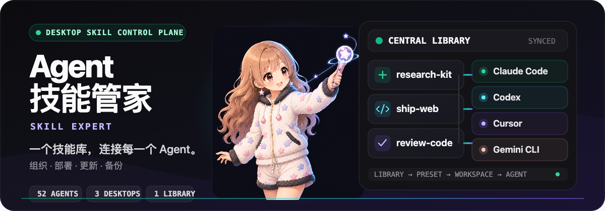
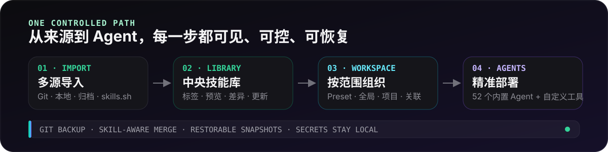

<p align="center">
  
</p>

<p align="center">
  <strong>One desktop control plane for every Agent Skill.</strong><br>
  Import once, organize clearly, deploy by Agent or project, and keep every change recoverable.
</p>

<p align="center">
  <a href="https://github.com/Alex-Shen1121/skill-expert/releases"><strong>Download</strong></a>
  &nbsp;·&nbsp;
  <a href="#start-in-three-steps">Quick start</a>
  &nbsp;·&nbsp;
  <a href="#cli">CLI</a>
  &nbsp;·&nbsp;
  <a href="./README.zh-CN.md">中文说明</a>
</p>

<p align="center">
  <a href="https://github.com/Alex-Shen1121/skill-expert/releases"></a>
  
  <a href="./LICENSE"></a>
</p>

## Why Agent 技能管家

Agent Skills usually end up scattered across global folders, project folders, Git repositories, archives, and different coding tools. Agent 技能管家 gives them one visible operating model:

- **One library, many sources** — install from Git, a local folder, `.zip` / `.skill` archives, or the [skills.sh](https://skills.sh) marketplace.
- **Deploy by real scope** — manage user-level Agent folders, project-local folders, or any linked skills root without mixing their boundaries.
- **Know what will change** — inspect `SKILL.md`, compare local and upstream content, batch-check updates, and stop before a removal needs human confirmation.
- **Recover from mistakes** — keep skill-aware Git history, restorable snapshots, and non-blocking conflict choices while secrets stay local.

<p align="center">
  
</p>

The concepts stay deliberately separate:

- **Library** is the central source of managed Skills.
- **Preset** is a reusable group applied as a one-time write, not a hidden live binding.
- **Global Workspace** reflects what an Agent actually sees in its user-level skills folder, including Skills installed outside this app.
- **Project Workspace** manages project-local Agent folders and syncs them with the library in either direction.
- **Linked Workspace** manages an arbitrary skills root as a standalone workspace.

## Start in three steps

1. Download the package for your platform from [Releases](https://github.com/Alex-Shen1121/skill-expert/releases).
2. Add a Skill from Git, a local folder, an archive, or the marketplace.
3. Click an Agent badge on the Skill card, or open **Global Workspace** / **Project Workspace** to deploy it at the right scope.

Optional: open **Backup**, sign in with GitHub once, and let versioned backup and multi-device sync run automatically.

## What you can manage

- **Skills** — search, preview, tag, filter, multi-select, export, delete, inspect sources, and compare upstream changes.
- **Presets** — build named Skill groups and activate them for selected Agents without losing per-Agent visibility.
- **Agents** — use 53 built-in integrations, reorder the Agents you use, change their paths, or add custom tools.
- **Workspaces** — control global, project, and linked Skills from the same interaction model.
- **Updates** — check and update in the foreground with visible batch progress, retry, stop, and configurable concurrency.
- **Operations** — choose symlink or copy mode, configure a proxy and theme, inspect activity history, and export logs for issue reports.
- **App updates** — receive update notifications on macOS and Windows; download, install, and restart only when you choose.

## Supported Agents

52 integrations are built in, including:

Claude Code · Codex · Cursor · GitHub Copilot · Gemini CLI · OpenCode · GitLab Duo · OpenClaw · Hermes Agent · OpenHands · Cline · Goose · Windsurf · Continue · Grok · Antigravity · Qwen Code · Crush · Kilo Code · Roo Code · Amp · Kiro CLI · Droid · TRAE IDE · Warp · Qoder · CodeBuddy

Detected Agents appear first in **Settings**. Custom tools use the same library, workspace, and deployment controls.

## Backup without lock-in

The **Backup** page stores the library in a normal Git repository. The guided GitHub setup creates a private `skill-expert-backup` repository, or you can connect any Git remote.

- Local changes are committed after you stop editing; updates from other devices are merged automatically.
- Merging is Skill-aware: a rename on one device can combine cleanly with an edit on another.
- True conflicts never overwrite the local version. Choose **keep mine**, **use remote**, or **keep both** after a safety snapshot is created.
- Skills, tags, Presets, and Agent toggles are backed up. Tokens, proxy settings, machine-specific wiring, and Skills over 100 MB stay local.
- The remote remains plain Git, so it can be cloned or inspected without Agent 技能管家.

## CLI

### GitLab Duo and custom Agent registration

Detailed protocol and isolated self-test commands: [Agent registration](docs/agent-registration.md).

GitLab Duo uses `~/.gitlab/duo/skills` for global deployment, `~/.agents/skills` for additional discovery only, and `<project>/.agents/skills` for project deployment. Shared discovery does not import Skills or grant ownership. Shared or uncertain project roots refuse moves, deletion, and replacement from the center; disabling an Agent globally does not revoke access to project files.

On Windows, edit the existing Skills path setting and enter the expanded absolute `%APPDATA%\GitLab\duo\skills` path. For custom configuration roots use the `skills` subdirectory of `GLAB_CONFIG_DIR`, or `XDG_CONFIG_HOME/gitlab/duo` when GLAB is unset. Variables are not expanded automatically. Per the [GitLab Agent Skills contract](https://docs.gitlab.com/user/duo_agent_platform/customize/agent_skills/), project support requires Duo CLI ≥8.73.0 or GitLab for VS Code ≥6.71.4; global skills require Duo CLI ≥8.83.0 and `--enable-global-skills true` or `GITLAB_ENABLE_GLOBAL_SKILLS=true`. Start a new session or load skills explicitly. A configured path does not prove vendor installation, authentication or loading.

```sh
skill-expert-cli agents add-custom my-agent --path "/absolute/skills path" --name "My Agent" --project-path .my-agent/skills
skill-expert-cli agents list
```

`tools` remains an alias of `agents`. KEY and `--path` are required; the default name is KEY. Omitted/blank project paths mean no project support. Names and paths are trimmed; global paths must be absolute or start with `~/`; project paths must be relative and cannot contain parent segments or resolve to the project root. Duplicate/reserved keys are rejected without overwrite. GUI and CLI use the same validation and configuration transaction. Refresh the desktop list after CLI changes in the same library; isolated `--skills-root` libraries and WSL installations are separate.

Registration returns `registered`, the normalized `definition`, `tool` (or null if unreadable), and an actual global `deployment` report. Exit 0 means saved plus complete or a proven `not_run`; it does not mean Duo loaded the Skill. Exit 1 means failure or incomplete deployment: confirmed saved definitions remain, and `DEPLOYMENT_INCOMPLETE` includes `registered=true`. A commit with an uncertain result uses `registered=null`; query the same KEY and compare all fields before retrying. A transport failure must not be treated as proof of rollback. Parse failures exit 2. Execution results are one JSON document on stdout for success or stderr for failure, both with and without `--json`. Reports distinguish committed/current/refused/failed/unconfirmed targets; an unknown total is null. Inspect both files and records before retrying an unconfirmed result.

A valid existing custom `gitlab_duo` retains its name, category, paths, project null, order and disabled state. There is no automatic conversion. Removing it leaves the built-in Agent disabled and preserves valid dormant overrides. Before explicitly enabling it, inspect the actual paths in the same library:

```sh
skill-expert-cli --skills-root /path/to/library agents list
skill-expert-cli --skills-root /path/to/library agents enable gitlab_duo
```

These are separate steps; the CLI does not prove the list was read or bind the path snapshot between commands. List again after concurrent changes. Damaged or ambiguous configuration blocks dependent writes; the startup failure view offers full process restart, sanitized diagnostics and exit, without clearing data. Ordinary settings remain supported, while the five Agent configuration keys use dedicated Agent operations.


The desktop app and `skill-expert-cli` use the same Rust core, SQLite database, central library, and deployment engine.

```bash
# Inspect the library
npm run cli -- repo status
npm run cli -- skills list

# Install, then deploy to selected Agents
npm run cli -- skills install vercel-labs/agent-skills@react-best-practices
npm run cli -- skills deploy <ref> --agent claude_code --agent codex

# Check upstream sources without changing deployed files
npm run cli -- skills check --all
```

<details>
<summary><strong>More CLI workflows</strong></summary>

```bash
# Preview a destructive or structural operation first
npm run cli -- skills remove <ref> --dry-run
npm run cli -- skills set-source <ref> --git-url you/skills --subpath my-skill --dry-run

# Organize and deploy a Preset
npm run cli -- presets create Frontend --description "Frontend workflow"
npm run cli -- presets add-skill Frontend <ref>
npm run cli -- presets deploy Frontend --agent codex

# Inspect actual per-Agent deployment state
npm run cli -- skills status <ref>
npm run cli -- skills undeploy <ref> --agent codex --dry-run

# Operate on an external skills checkout without polluting it
npm run -s cli -- --skills-root /path/to/my-skills --json skills list

# Install the binary on PATH
npm run cli:install
```

当 `--skills-root` 指向外部检出目录时，CLI 的数据库和缓存等状态保存在 `~/.skill-expert/external/` 下，外部检出目录本身不会被污染。

Website skills: `skill-expert-cli skills install https://skills.sh/site/open.feishu.cn/lark-im`. These are snapshots, excluded from Git updates and source comparisons. Reinstall with `--replace` to confirm replacing the existing snapshot and local changes. Desktop users can paste the same link under Install from Git or a website; the preview asks for confirmation.

An update replaces the Skill folder. If upstream removed paths that still exist locally, the CLI applies nothing and reports `held_back_removals`; a person must confirm that loss in the desktop app.

The CLI and desktop app share the same repository lock. If the app was suspended while a command ran, trigger one manual refresh.

</details>

## Development

### Prerequisites

- Node.js 18+
- Rust toolchain
- [Tauri 2 prerequisites](https://v2.tauri.app/start/prerequisites/) for your platform

```bash
npm install
npm run tauri:dev
```

| Layer | Technology |
| --- | --- |
| Frontend | React 19, TypeScript, Vite, Tailwind CSS |
| Desktop | Tauri 2 |
| Core | Rust |
| Storage | SQLite (`rusqlite`) |
| Localization | `react-i18next` |

Build commands:

```bash
npm run tauri:build
npm run cli:build
```

## Downloads and support

Download current packages from [Agent 技能管家 Releases](https://github.com/Alex-Shen1121/skill-expert/releases).

### Opening the macOS app safely

macOS packages are ad-hoc signed but not notarized. If Gatekeeper blocks the first launch, try opening the app once, then go to **System Settings → Privacy & Security → Open Anyway** and confirm. Keep Gatekeeper enabled; this approves only Agent 技能管家. See the [test package guide](docs/test-packages.md) for on-demand test builds.

Report reproducible problems with **Settings → Report Issue** or the [Issue tracker](https://github.com/Alex-Shen1121/skill-expert/issues). Contributions are welcome; read [CONTRIBUTING.md](CONTRIBUTING.md) before opening a Pull Request.

## License

[MIT](LICENSE)
